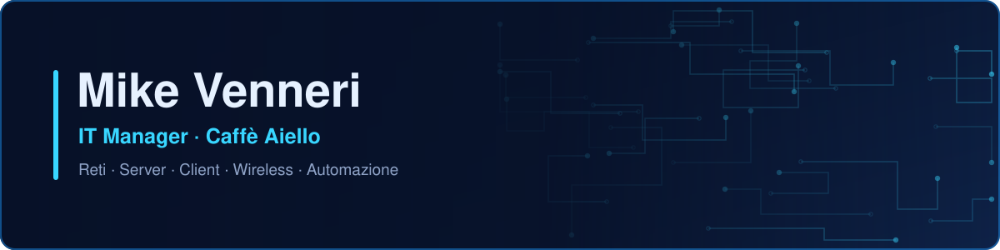

Gestisco l'infrastruttura informatica di **Caffè Aiello**: rete, server, postazioni e Wi-Fi. Lavoro soprattutto su **Linux**; Windows e macOS li seguo per le postazioni. Quando un lavoro si ripete, lo trasformo in uno strumento, e quelli che funzionano li pubblico qui.

  
  
  
  
  

## Strumenti per Linux

<table>
<tr>
<td width="50%" valign="top">

### 🐧 [VM Linux Health Check](https://github.com/Mivenner/vm-linux-health-check)
Lo stato di un server in pochi secondi: dischi, servizi, aggiornamenti, sicurezza, certificati. Report HTML con semaforo, in sola lettura.

</td>
<td width="50%" valign="top">

### 🌐 [VM Network Check](https://github.com/Mivenner/vm-network-check)
Chi c'è in rete, quali porte espone e cosa è cambiato dall'ultima scansione: nuovi dispositivi, nuove porte, MAC diversi.

</td>
</tr>
<tr>
<td width="50%" valign="top">

### 🛠️ [VM Server Setup](https://github.com/Mivenner/vm-server-setup)
Prepara un server appena installato da un profilo: utente amministratore, SSH, firewall, aggiornamenti automatici. Prima il piano, poi l'applicazione.

</td>
<td width="50%" valign="top">
</td>
</tr>
</table>

Script bash senza dipendenze, con report HTML/JSON, provati a ogni modifica su dieci distribuzioni (Debian, Ubuntu, Rocky, Alma, Fedora, openSUSE, Arch, Alpine).

## Strumenti per le postazioni Windows

<table>
<tr>
<td width="50%" valign="top">

### 🔄 [VM Migration Suite](https://github.com/Mivenner/vm-migration-suite)
Sposta un profilo utente da un PC all'altro: dati, browser, Office, registro, Wi-Fi e stampanti. Via USB o direttamente in LAN.

</td>
<td width="50%" valign="top">

### 🩺 [VM Health Check](https://github.com/Mivenner/vm-health-check)
Lo stato di un PC in pochi minuti: dischi, eventi, sicurezza, aggiornamenti, rete. Report HTML/PDF con semaforo, in sola lettura.

</td>
</tr>
<tr>
<td width="50%" valign="top">

### ⚙️ [VM Setup Suite](https://github.com/Mivenner/vm-setup-suite)
Prepara un PC nuovo partendo da un profilo: pulizia, applicazioni, impostazioni, stampanti, utenti, BitLocker.

</td>
<td width="50%" valign="top">

### 🖨️ [VM Printer Manager](https://github.com/Mivenner/vm-printer-manager)
Esporta e importa le stampanti installate: driver, porte, impostazioni e predefinita. Prima versione, in fase di prova.

</td>
</tr>
</table>

Tutti hanno interfaccia grafica in italiano, riga di comando e versione portatile, e vengono compilati su Windows a ogni modifica.

## Di cosa mi occupo

- **Reti e wireless**: progettazione e gestione di LAN, VLAN, VPN e Wi-Fi aziendale
- **Server e virtualizzazione**: sistemi Linux, Proxmox, backup e ripristino
- **Postazioni**: installazione, migrazione e manutenzione di client Windows e macOS
- **Integrazione**: collegamento tra gestionale, applicazioni per la forza vendita e servizi aziendali

 vm technology · Italia

